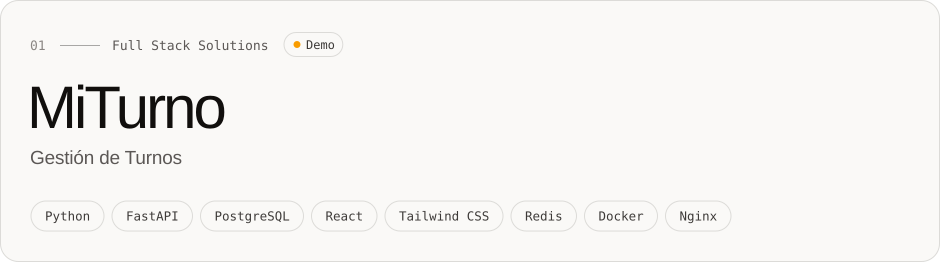
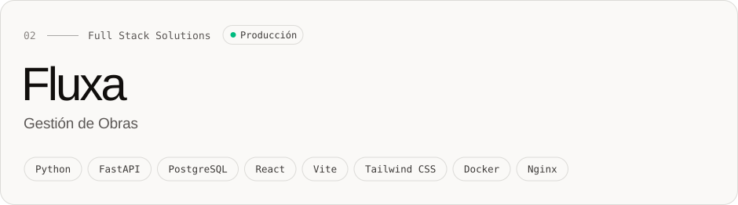
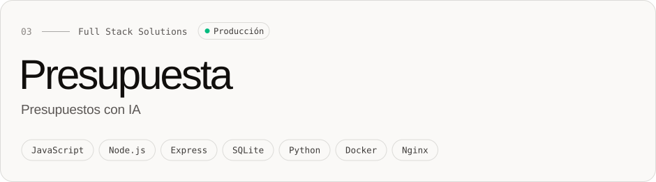
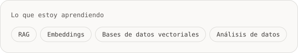

 

Soy **Técnico en Informática** y desarrollador de software, con dos años de experiencia práctica desarrollando aplicaciones web, sistemas de gestión e integraciones. Trabajo con **Python, React y PostgreSQL**, y sumo automatización e inteligencia artificial cuando aportan valor real, manteniendo el criterio técnico sobre el código. Estudio la **Licenciatura en Ciencia de Datos** en la Universidad Siglo 21.

| Qué hago | Cómo lo aplico |
|:--|:--|
| **01** &nbsp; Desarrollo de software | Aplicaciones web y sistemas de gestión, del modelado de datos al despliegue. |
| **02** &nbsp; Inteligencia artificial aplicada | Modelos de lenguaje integrados por API: asistentes conversacionales y procesamiento de información. |
| **03** &nbsp; Automatización e integraciones | Python y JavaScript para conectar servicios y simplificar procesos repetitivos. |
| **04** &nbsp; Comunicación y trabajo en equipo | Coordiné un equipo de tres personas en proyectos con requerimientos reales de empresas y pymes. |

 

Aplicaciones que diseñé y desarrollé: el problema que resuelven, mi participación y las tecnologías utilizadas.

 

Plataforma web de turnos para negocios de servicios: los clientes reservan servicio, profesional y horario, y cada negocio administra su agenda, profesionales, clientes y recordatorios desde su propio panel. Varios negocios conviven en la misma aplicación con **sus datos separados a nivel de base de datos** (Row Level Security), un índice único impide la doble reserva y un bot de WhatsApp con IA responde consultas y toma turnos.

 

PWA **offline-first** para gestionar obras desde el celular que reemplaza el cuaderno de obra. Centraliza asistencia, pagos semanales con adelantos, cuadrillas y herramientas, y **sincroniza sola cuando vuelve la señal**, en orden y sin duplicados. La primera pantalla pesa cerca de 100 KB comprimidos; pruebas y CI en GitHub Actions.

 

Aplicación mobile-first para armar presupuestos de obra por ítems desde el celular, con **dictado por voz**, interpretación de jerga local mediante IA y exportación a PDF. El profesional revisa lo que la IA propone antes de aplicarlo: **la aritmética la resuelve el servidor, no el modelo**. Más de 180 pruebas automatizadas.

 

| Proyecto | Qué es | Stack |
|:--|:--|:--|
| **aceroGYM** · en producción, repo privado | Backoffice para gimnasios: socios, membresías, clases, accesos y caja auditable | Python · React · PostgreSQL |
| [FinBot WhatsApp](https://github.com/SoyMonardez/bot_whatsapp) | Registra y consulta gastos familiares desde WhatsApp, con texto o audio | FastAPI · Whisper · Llama |
| [Etán Construcciones](https://github.com/SoyMonardez/Et-n_portafolio_empresa) | Freelance: sitio y panel de gestión para una constructora, con analítica propia e IA | React · Express · PostgreSQL |
| [Portfolio personal](https://github.com/SoyMonardez/portafolio_AlejoMonardez) | Sitio bilingüe con CMS propio y edición asistida por IA | React · Express · MySQL |
| [Gancho](https://github.com/SoyMonardez/gancho-app) | MVP de punto de venta por peso para carnicerías | React · Express · MySQL |
| [Natasha Models Academy](https://github.com/SoyMonardez/NatashaModelsAcademy) | Plataforma para una academia de modelaje con panel de administración | React · TypeScript · Prisma |

 

Lo que uso de verdad en mis proyectos: Python, JavaScript y lo necesario para llevarlos a producción.

 

